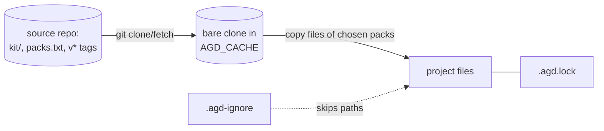

# agd

## Purpose

A CLI that installs agentic setups (instructions, agents, skills, hooks) from git repositories, called sources, into projects, and keeps them up to date without overwriting the project's own edits. agentic-defaults is the default source. Users are developers running it on their own projects.

Not responsible for: the kit content itself (it lives in each source, for example github.com/Zejnilovic/agentic-defaults), and running anything from a source: agd only copies files.

## Tech stack

- Bash 3.2-compatible shell script (macOS `/bin/bash`, Linux bash, Git Bash on Windows), git and POSIX tools only.
- Python 3 `unittest` for the tests, no third-party packages.
- MkDocs (`docs/requirements.txt`) for the documentation site.
- GitHub Actions for CI, docs and releases; Homebrew tap `Zejnilovic/homebrew-tap`.

## Structure

- `bin/agd`: the whole tool. Usage comment at the top is also `agd --help` (printed by `usage()`).
- `install.sh`: installs or updates `bin/agd` from a GitHub release into a folder on `PATH`.
- `tests/test_agd.py`: all tests: version and release scripts, `install.sh`, then one class per agd command area (`AgdInitTest`, `AgdUpdateTest`, ...), built on `AgdCase`.
- `scripts/`: `bump.sh` (start a version), `release.sh` (date the changelog entry, write notes), `formula.sh` (print the Homebrew formula). Run by the maintainer and the Release workflow.
- `docs/`, `mkdocs.yml`: the site for people. `docs/reference/commands.md` and `docs/reference/files.md` describe commands and files.
- `.github/workflows/`: `check.yml` (syntax and tests on Linux and macOS), `docs.yml` (site), `release.yml` (release).
- `.claude/`, `.local_context/`, `AGENTS.md`, `CLAUDE.md`, `.agd.lock`: this repository's own agentic setup, installed by agd from agentic-defaults.

## How it fits together

`agd` keeps a bare clone of each source in the cache (`AGD_CACHE`, default `${XDG_CACHE_HOME:-~/.cache}/agd`), named after its URL, and reads releases from `v<x.y.z>` tags. It copies the files of the chosen packs into the project and records each file's installed git blob in `.agd.lock`. Updates compare project file, installed blob and new kit file to decide whether to update, keep, or leave a changed file alone.

## Domain

- Source: a git repository with `kit/` (or the `root` named in `packs.txt`), `packs.txt` and release tags. Several sources can be installed in one project; a pack names another source's pack as `<source>:<pack>`.
- Pack: a named set of kit paths in `packs.txt`, with `requires` on other packs. `min-agd` names the oldest agd that can install the source.
- Project parts: what updates keep in a kit file: an agent's `model:` and `tools:` front-matter lines, and a closing `## This project` section of a Markdown file (`part()` and `compose()` in `bin/agd`).
- Taken: a project file already at a kit path; `init` leaves it and doesn't install that file.

## Contracts

- `.agd.lock`: line format `agd-lock 1`, then `source <name> <url> <version>`, `pack <source> <pack>`, `file <source> <path> <blob>` lines. Written only by `write_lock()`.
- `.agd-ignore` (and the older `.agentic-defaults-ignore`): paths agd must not install or update.
- Source layout and `packs.txt` syntax.
- The release file names `agd`, `SHA256SUMS`, `agd-<version>.tar.gz`, and the `install.sh` URL, which users copy into scripts.

Changing any of these needs a major version (see AGENTS.md "Contracts").

## Running it

Commands are in AGENTS.md "This project". The tests need only git, bash and Python 3; nothing reaches the network.

## Conventions

- State in `bin/agd` lives in temporary files under `$tmp` (removed on exit) and line-based lists read with `awk`, never arrays.
- Each `cmd_<name>()` function implements one command; the dispatch `case` is at the end of the script.
- Errors go through `die()`, which exits 2.
- Tests run the script as a subprocess against temporary source repositories and projects, with `GIT_CONFIG_GLOBAL=/dev/null`; GitHub URLs are faked with `url.<path>.insteadOf`.

## Invariants and gotchas

- `.gitattributes` export-ignores the agentic setup, so the release archive (`git archive` in `release.yml`) holds agd only. `ReleaseTest.test_archive_leaves_out_the_agentic_setup` checks it.
- `VERSION` and `version=` in `bin/agd` must match (`VersionTest`).
- `agd feedback` never posts: it runs `gh issue create --web` or prints a link, because notes may hold private code. It finds the owner by matching lock paths in the note's text (`cmd_feedback`); without a note, `ask_feedback` turns terminal answers into one in `$tmp`, picking files with fzf when `command -v fzf` finds it. Its tests hide `gh` and `fzf` behind a `PATH` of symlinks and fake them when needed. Its tests write `.agd.lock` themselves.
- Tab completion: `agd completion bash|zsh` prints a script that calls the hidden `agd __complete <words> <word at the cursor>` (`cmd_complete`), which prints candidates, or `:dirs`/`:files` for the shell to complete paths. `__complete` skips the option parser and writes nothing, not even to the cache: releases come from `git ls-remote` (`live_releases`, killed after 3 seconds, skipped with `--offline`) plus the cache, and it offers no packs of a source that isn't installed, since those need a fetch. bash splits words at `:` and `=`, so the bash script splits `COMP_LINE` itself and trims candidates. The Homebrew formula installs both scripts (`generate_completions_from_executable`).
- The kit text above "## This project" in `AGENTS.md` mentions `` `## This project` `` inline; split on the heading line, not the first match.
