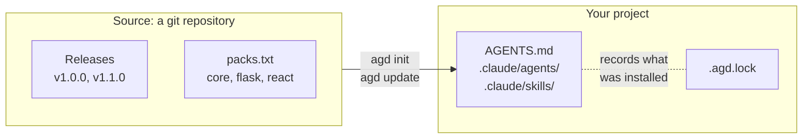

# How agd works

## The idea

A good agentic setup takes work: the instructions in `AGENTS.md` or `CLAUDE.md`, agents for each role, skills for each practice, hooks and the scripts they run. Once it works, you want it in every project, and you want every project to get its improvements.

Copying it doesn't last. The copies drift, nobody knows which version a project has, and copying a new version over an old one wipes out what the project changed: a cheaper model for one agent, a project's own rules. So projects stop updating.

agd treats a setup like a dependency, and keeps it as plain files:

- **Versioned.** A setup is published as releases of a git repository. A project installs a release, records it in a lock file, and updates with one command, with links to the release notes.
- **In your repository.** agd copies files, nothing more. Your agents read them as they are, people review them in pull requests, and git keeps their history. There is no plugin to load and no runtime, and it works with any assistant that reads files: Claude Code, GitHub Copilot, Cursor, Codex and others.
- **Yours to change.** agd remembers exactly what it installed, so it can tell your changes from the source's. It updates what you didn't touch, keeps the parts that belong to the project, and never overwrites a file you changed.
- **Combinable.** A project can install several sources, for example your team's setup on top of agentic-defaults, and choose what it takes from each.
- **Small and safe.** agd is one bash script that needs only git. It never runs code from a source.

## Words agd uses

**Source**
:   A git repository that publishes a setup, such as [agentic-defaults](https://github.com/Zejnilovic/agentic-defaults) or your team's. agd names it after the repository. Its files sit in `kit/`, or wherever its `packs.txt` says. The output sometimes calls a source's files "the kit".

**Release**
:   A tag like `v1.2.0` in the source. agd installs the newest one unless you name another, or a commit.

**Pack**
:   A named group of a source's files, such as `core` or `flask`, listed in its `packs.txt`. A pack can require others. A source without `packs.txt` is one pack, `core`.

**Lock**
:   `.agd.lock` in your project. It records each source with its URL and version, the packs you chose, and every file agd installed, with the git hash of the content it installed. You commit it.

**Project parts**
:   The parts of an installed file that belong to the project, and that updates keep: an agent's `model:` and `tools:` lines, and a `## This project` section at the end of a Markdown file.

**Edit**
:   Any other change you make to an installed file. agd never overwrites an edit; `agd status` lists it, and [`diff`, `merge` and `reset`](guides/your-changes.md#settle-an-edited-file) settle it.

**Taken**
:   A path where your project already has a file of its own when agd would install one. agd leaves your file alone and doesn't install the source's.

**Ignored**
:   A path listed in `.agd-ignore`. agd doesn't install it, and stops managing it if it did.

## What an update does

For each file, agd compares three versions: what it installed (from the lock), what is in your project, and what is in the new release. Changes to project parts don't count as edits.

| Your copy | The new release | `agd update` |
|---|---|---|
| Unchanged | Same file | Nothing to do. |
| Unchanged | Changed | Replaces it, and puts the project parts back. |
| Edited | Same file | Leaves it. `agd status` lists it as edited. |
| Edited | Changed | Leaves it, and tells you a newer version is available: diff, merge or reset it. |
| Unchanged, without project parts | Removed | Deletes it. |
| Edited, or with project parts | Removed | Keeps it, as a project file. |
| Deleted by you | Any | Leaves it deleted, and reminds you. List it in `.agd-ignore` to stop the reminder. |
| Listed in `.agd-ignore` | Any | Stops managing it. The file stays. |
| No file at that path | New file | Installs it, when its pack is installed. |
| A project file at that path | New file | Leaves the project's file. The path is taken. |

agd only ever writes files listed in the lock, or new files at free paths. Files your project wrote itself are never touched. Line endings and trailing blank lines don't count as edits.

## What agd doesn't do

- **It doesn't run anything from a source.** Scripts and hooks a setup ships run only when an agent or a person runs them, as with any file in your repository.
- **It doesn't know about assistants.** It copies files to the paths a source gives them. Which tool reads them is up to the source and your project.
- **It doesn't need a server.** Sources are git repositories. agd keeps a bare clone of each in `~/.cache/agd`, so it can work `--offline`.
- **It doesn't change git.** agd writes files and the lock; you review and commit them.
